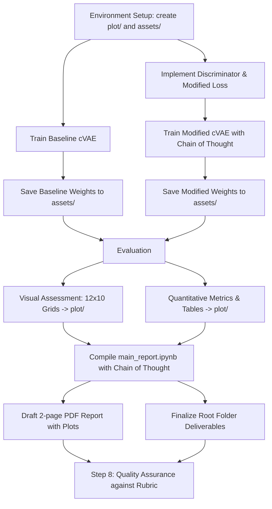

# Development Plan: The Sharpness Quest

Based on the instructions provided in `instruction.md` and the supporting materials, here is a detailed, step-by-step development plan to complete this project.

The main objective is to investigate the hypothesis: **"Adding a discriminator term to the loss function of a cVAE during training increases the sharpness of the reconstructed images."**

## Step 1: Environment & Project Setup

1. **Initialize Directory Structure:**
   The deliverables will be saved directly in the project's root folder. Create `plot/` (for all generated plots and visual outputs) and `assets/` (for model weights and training histories) directories.
2. **Review Baseline:**
   Extract and review the standard Conditional Variational Autoencoder (cVAE) implementation from the provided `w8_tutorial.ipynb`. Ensure the data loader is set up to use the "modified MNIST dataset" located in `reference/Data/MNIST`.
3. **Literature Review:**
   Review the provided NIPS 2015 paper (`NIPS-2015-learning-structured-output-representation-using-deep-conditional-generative-models-Paper.pdf`) and research related works (e.g., VAE-GAN) to understand how a discriminator loss is typically integrated into the VAE objective.

## Step 2: Implement and Train Baseline cVAE

1. **Model Implementation:**
   Extract the standard cVAE code into a reusable Python module or a baseline notebook.
2. **Constraint Enforcement:**
   Ensure the latent space uses exactly **7 latent dimensions** as explicitly required.
3. **Training & Checkpointing:**
   Train the baseline model to convergence. Implement checkpointing to save the final model weights and training loss history (e.g., as `.pkl` or `.pt` files) into the `assets/` directory. These will be needed for reproducibility in the final report notebook.

## Step 3: Implement Modified cVAE with Discriminator Loss

1. **Discriminator Architecture:**
   Design and implement a Discriminator network suitable for MNIST images (e.g., a simple CNN).
2. **Loss Function Modification:**
   Modify the cVAE training loop to incorporate the Discriminator loss. The total objective will combine the standard VAE loss (Reconstruction Loss + KL Divergence) with an adversarial loss term, creating a cVAE-GAN hybrid setup.
3. **Notebook Creation (Chain of Thought):**
   Implement the full training and architecture for this model in `cVAE_DiscriminatorLoss.ipynb` at the project root. **Crucially, the notebook must demonstrate a step-by-step chain of thought, with each step properly explained and reasoned.**
4. **Training & Checkpointing:**
   Train this modified model to convergence using comparable settings to the baseline. Save the weights and loss logs into the `assets/` directory for reproducibility.

## Step 4: Visual and Qualitative Evaluation

1. **Conditional Sampling:**
   Implement an inference function that accepts a digit class (0-9) and samples from the prior distribution to generate images.
2. **Grid Generation:**
   Generate **12 samples per digit** (for all 10 digits) yielding a total of 120 images per model.
3. **Visual Comparison & Saving Plots:**
   Plot a 12x10 grid for both the baseline and the modified cVAE. Analyze the generated images for quality, sharpness, consistency, and variety. **Always save these generated visual grids directly into the `plot/` directory.**

## Step 5: Quantitative Evaluation

1. **Select Metrics:**
   Implement objective metrics to measure visual quality and sharpness. Utilize as many evaluation metrics, plots, and tables as possible to deeply support the report. Good candidates include:
   - **Sharpness Metric:** Laplacian Variance (measures edge sharpness).
   - **Distribution Quality:** Fréchet Inception Distance (FID) to assess realistic distribution.
   - **Class Consistency:** A standalone pre-trained MNIST classifier to measure how recognizable the generated digits are (Inception Score proxy).
2. **Compute Metrics & Save Outputs:**
   Calculate and tabulate these metrics comparing the Baseline vs. Discriminator-enhanced model. Generate comparison plots (e.g., loss curves, metric bar charts) and save all of them to the `plot/` directory.

## Step 6: Assemble Deliverables (Root Folder)

1. **Compile `main_report.ipynb` (Chain of Thought):**
   Create a Jupyter notebook that loads the saved weights from `assets/`, generates the 12x10 grids for both models (saving to `plot/`), and calculates the quantitative metrics. This notebook must also demonstrate a step-by-step chain of thought, with clear reasoning for every step. Ensure this notebook runs flawlessly without retraining.
2. **Verify Portability:**
   Check that all pickle files, model weights in `assets/`, and auxiliary files are correctly placed and the notebook is reproducible (especially targeting the IFN680 computing environment constraint).
3. **Archive Directory:**
   Zip the root project directory (excluding unnecessary files) for submission if required.

## Step 7: Draft the PDF Report

Draft the professional 2-page PDF report containing:

- **Introduction:** Hypothesis statement, bibliographic references on cVAE and discriminator losses.
- **Methodology:** Details on the baseline architecture and the discriminator loss additions.
- **Experiments:** Explanation of the training procedure and the evaluation metrics used.
- **Discussion:** In-depth analysis of the quantitative/qualitative results, presenting the generated images and discussing whether they support the hypothesis. **Include relevant plots and tables from the `plot/` directory to strongly justify your findings.**
- **Conclusion:** Summary of findings and potential future work.

## Step 8: Quality Assurance against Rubric

Before final submission, review all deliverables against the project rubric:

**Code Quality Checklist:**
- [ ] Code demonstrates mastery of advanced AI/ML techniques.
- [ ] Code is consistently clean, logical, and professionally structured (e.g., modular designs).
- [ ] Best practices are followed for naming conventions and readability (self-explanatory variables).
- [ ] Every non-obvious part of the code is well-commented.
- [ ] Notebooks demonstrate a step-by-step chain of thought and proper reasoning.
- [ ] The code can be understood easily without further explanation.

**Report Quality Checklist:**
- [ ] **Clarity and presentation:** Written at the highest professional standard (spelling, grammar, formatting, terminology).
- [ ] **Technical explanation:** Critically evaluates results using clear, detailed evidence. Synthesizes strengths and limitations, providing well-reasoned recommendations.
- [ ] **Expected Performance:** Generated images show good quality, diversity, and consistency. 
- [ ] **Evaluation:** The comparison is supported by a wealth of appropriate visual/quantitative evaluations, plots, and tables from the `plot/` directory, leading to reasonable conclusions.

---

### Workflow Diagram

## Step 9: Future Work & Critical Review (Round 2 Improvements)

Following the initial development and evaluation, a critical review reveals several areas where the VAE-GAN hybrid logic and evaluation metrics can be advanced in future iterations:

### 1. VAE-GAN Training Logic Flaws & Improvements
- **The "Prior Sampling" Blind Spot:** Currently, the discriminator is only trained to distinguish between real images and reconstructed images (decoded from $z \sim q_\phi(z|x)$). It is not trained on images generated from purely random prior noise ($z \sim \mathcal{N}(0, I)$). This may cause the decoder to fail at producing sharp images during pure generation. **Fix:** Ensure the discriminator evaluates both reconstructed and prior-sampled images.
- **Feature Matching Loss:** The current training relies on pixel-wise MSE, which fundamentally conflicts with adversarial sharpness (MSE encourages blurring). **Fix:** Following the original VAE-GAN paper, replace pixel-wise MSE with a Feature Matching Loss extracted from the intermediate layers of the discriminator.

### 2. Discriminator Stability Improvements
- **Missing Normalization:** The discriminator architecture uses only Convolutional layers and LeakyReLU. **Fix:** Add Spectral Normalization or Batch Normalization to stabilize the adversarial training loop and prevent the discriminator from overpowering the generator.
- **Static Loss Balancing:** The adversarial weight is statically set to `0.5`. **Fix:** Implement dynamic weighting or adopt WGAN-GP (Wasserstein GAN with Gradient Penalty) to balance the GAN loss against the KL-Divergence and reconstruction losses.

### 3. Advanced Evaluation Metrics
- **Fréchet Inception Distance (FID):** The Laplacian Variance metric is a good baseline but is highly sensitive to high-frequency noise and artifacts. **Fix:** Implement FID or Kernel Inception Distance (KID) to evaluate the holistic quality and distribution match of the generated images.
- **Latent Space Interpolation:** While statistical density (KDE/Histograms) was analyzed, the smoothness of the learned manifold was not visually tested. **Fix:** Implement Spherical Linear Interpolation (Slerp) between latent vectors to verify that the discriminator did not create unnatural "holes" in the latent manifold.
